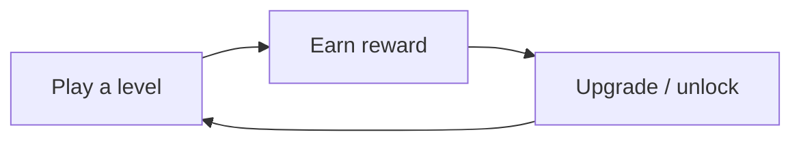

# {{displayName}}: Game Design (one page)

> Kept short and current. Changes to mechanics, economy or monetization update this file in the same PR.

## Pitch
{{One sentence: who, what they do, why it's fun.}}

## Target audience
- Age: {{e.g. 13+}} (if children are included: Families policy, non-personalized ads only)
- Platforms: {{iOS / Android}} · Orientation: {{portrait / landscape}} · Session length target: {{e.g. 3–5 min}}

## Core loop

## Controls
| Input | Action |
|---|---|
| {{tap / swipe / drag}} | {{...}} |

## Progression
- Worlds / chapters: {{...}} · Levels per world: {{...}}
- New mechanic introduced every {{N}} levels. Level map: [levels.md](levels.md) (generated).

## Economy
| Currency | Earned by | Spent on | Target |
|---|---|---|---|
| {{coins}} | {{level reward, rewarded ad}} | {{skins, boosters}} | {{first skin by level 5}} |

## Monetization placements
| Placement | Type | Rule |
|---|---|---|
| {{double reward}} | Rewarded | user's choice only |
| {{level end}} | Interstitial | not before level {{3}}, ≥ {{60}} s apart |
| {{remove ads}} | IAP non-consumable | Restore Purchases available |

## Analytics funnel and KPIs
- Events: `level_start`, `level_complete`, `level_fail`, `currency_earn`, `currency_spend`, `ad_reward`, `purchase`
- KPIs: D1 {{40%}}, D7 {{15%}}, avg session {{4 min}}, fail rate per level < {{40%}}

## Art and audio direction
{{Style, palette, references; music mood; sfx style.}}

## Scope
- **v1 includes:** {{...}}
- **Not in v1:** {{...}}
