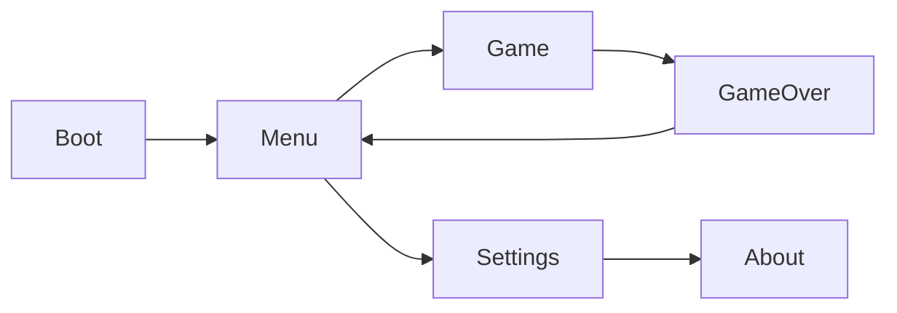
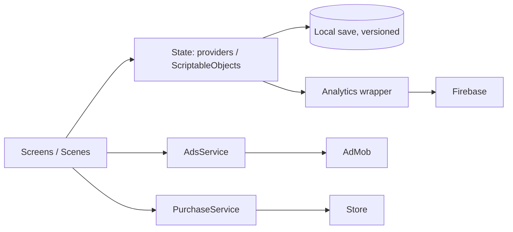
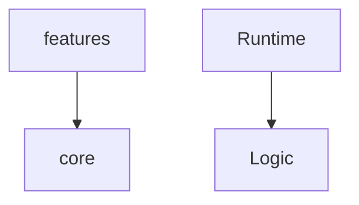

# {{displayName}}: Project Map

> {{one-line summary}} · Type: {{type}} · Platforms: {{platforms}}
> Update this file in the same PR as any structural change (logspace:project-map). The guard checks that feature/scene names are mentioned here.

## Folder tree

```
{{2-3 level tree, one-line purpose per important folder}}
```

## Modules

| Module | Folder | Responsibility | Depends on |
|---|---|---|---|
| about | `{{path}}` | About screen, links from brand.json | core/brand |

## Flow



## Data flow and external services



## Dependency direction



Never the other way; `core` / `Logic` don't know about features or the engine.

## Entry points

- {{main.dart / src/main.ts / Boot scene / app/[locale]/layout.tsx}}

## Where to add...

| I want to add | Where |
|---|---|
| a new screen / scene | {{path}}, then add it to the flow above |
| a translation | {{l10n path}}, all 13 languages |
| an analytics event | {{analytics wrapper path}} |
| a level | {{levels path}} (logspace:game-design) |
